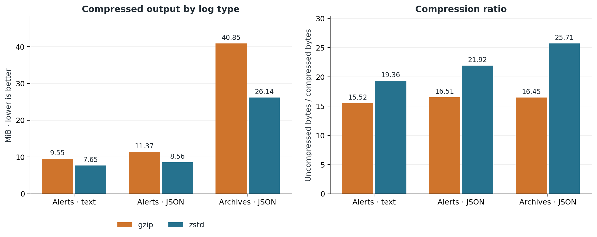
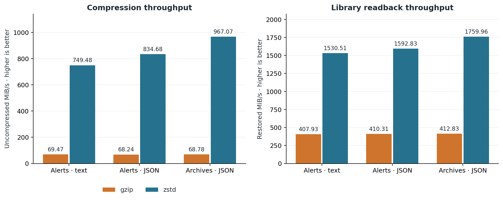
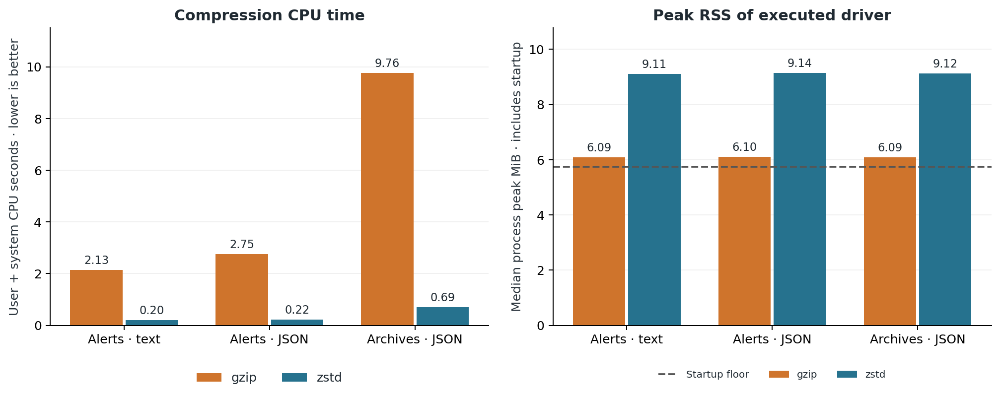
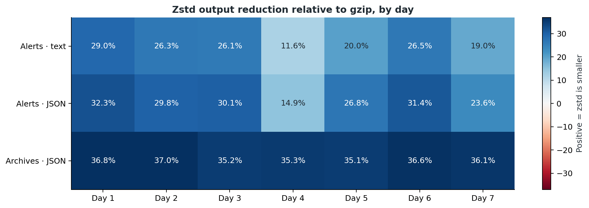
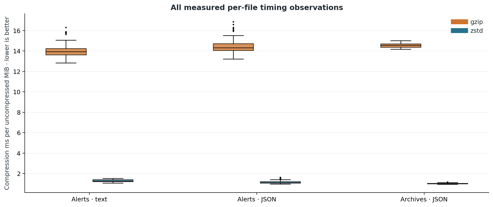
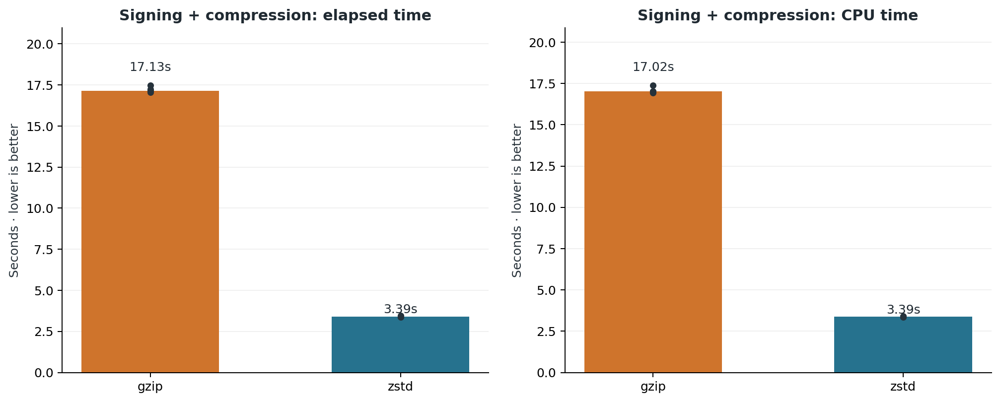
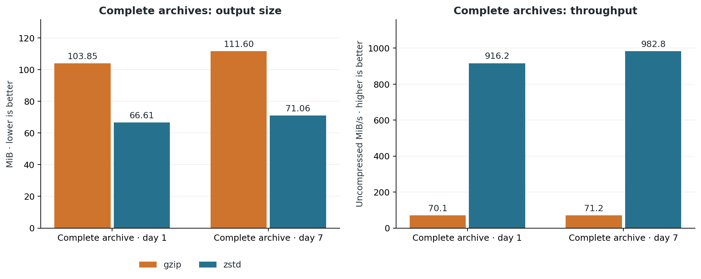

# Wazuh manager: gzip versus zstd on real supervision logs

## Findings

For the primary 21-file corpus, zstd level 3 produced **31.44% smaller output** than the existing gzip default (level 6), and compression was **13.11× as fast** by the aggregate of per-file median wall times. This is the result for this specific corpus and host, not a universal guarantee.

Production signing plus compression of the same corpus took **17.134s with gzip** and **3.393s with zstd**, a **5.05× speedup**. The two complete JSON archive files independently checked the sampled archive behavior: combined output changed by **36.10%** and aggregate compression speedup was **13.44×**.

Compression CPU time for the primary corpus fell by **92.37%**. Median standalone-driver peak RSS was **6.09 MiB with gzip** and **9.12 MiB with zstd**; this is a memory tradeoff, not the full daemon footprint. Readback throughput improved by **4.10×** in the separate common decoder harness. The unchanged signing work reduces the end-to-end gain relative to compression alone.

Every compressed output was read back and matched its original SHA-256. Raw logs, server addresses, usernames, and log excerpts are excluded from this report.

## Corpus and sampling

The source manager reported `v4.14.10-rc2` at collection time; this is provenance, not the benchmark binary version. The primary corpus contains seven consecutive completed days: seven complete alert text files, seven complete alert JSON files, and seven sampled JSON archive files. The text archive was empty on the source server and is therefore not represented. Newline counts describe lines, not alert/event counts.

The 13.549 GiB source corpus yielded 1007.86 MiB of primary benchmark input. Each archive contributes three approximately 32 MiB windows from the beginning, middle, and end. Partial boundary lines were removed and windows concatenated in order. Full gzip sources were streamed to EOF with CRC validation and stable size/mtime checks during collection. Raw sample SHA-256 hashes were verified after transfer. Collection used a read-only, low-priority pass; no benchmark ran on the source server.

Alerts were retained in full while archives were sampled. This intentionally oversamples alerts relative to original source volume. **The sample-total result is not a production-volume-weighted estimate of the complete week.** Results by log type and two complete archive days are provided to expose that limitation. No data or day was selected based on compression outcome.

## Production defaults: measured size and speed

| Dataset type | Raw MiB | Gzip MiB | Zstd MiB | Zstd output reduction vs gzip | Compression speedup |
|---|---:|---:|---:|---:|---:|
| Alerts · text | 148.17 | 9.55 | 7.65 | 19.86% | 10.79× |
| Alerts · JSON | 187.73 | 11.37 | 8.56 | 24.70% | 12.23× |
| Archives · JSON | 671.96 | 40.85 | 26.14 | 36.02% | 14.06× |

## Complete archive cross-check

| Complete file | Raw MiB | Gzip MiB | Zstd MiB | Zstd output reduction vs gzip | Compression speedup |
|---|---:|---:|---:|---:|---:|
| F01-archives-json | 1725.22 | 103.85 | 66.61 | 35.86% | 13.07× |
| F07-archives-json | 1921.31 | 111.60 | 71.06 | 36.32% | 13.80× |

These two files are full day-1 and day-7 archives from the same week. They validate large-file behavior and sampling sensitivity, but are not independent new days and are not double-counted in primary totals.

## Measurement protocol

- Execute the actual production `OS_CompressLog()` and `OS_CompressLogZstd()` routines, selected through the shared `ossec.conf` configuration reader. Do not substitute CLI compressors or tune levels after observing results.
- Gzip uses zlib 1.3.1 default compression, equivalent to level 6. Zstd uses library 1.5.7 default level 3. Both use their existing streaming configuration and one thread.
- Framing/window settings are the production defaults, not matched tuning knobs: gzip includes its mandatory CRC32 and a 32 KiB DEFLATE window; the current zstd stream uses a 2 MiB window and its optional frame checksum is off. Existing Wazuh `.sum` generation is unchanged, and benchmark readback is independently SHA-256 verified. Enabling zstd frame checksums would be a separate implementation/configuration change requiring remeasurement.
- Fresh production build of commit `697185f4f611fece0e91f0203b8bbbe7ef5f3f42` with the standalone benchmark harness; no sanitizer or profiling preload. Build command: `make TARGET=server -f Makefile -f ../tests/compression/benchmark/Makefile compression-benchmark`.
- Pin the driver to logical CPU 2 in Docker Desktop's Linux VM. VM reports 16 logical CPUs and 15.28 GiB RAM; CPU model: AMD Ryzen 7 260 w/ Radeon 780M Graphics. Compiler: GCC 11.4.0; kernel: Linux 6.18.58.1-microsoft-standard-WSL2 x86_64 GNU/Linux.
- Seven measured primary repetitions per dataset/method after one verified warm-up. Shuffle datasets with seed 20261116; alternate method order within each round. Complete-file validation uses three measured repetitions after one warm-up. The signing/compression batch uses five measured repetitions after one warm-up.
- Time with `CLOCK_MONOTONIC` around the actual operation only; CPU is user plus system time from `getrusage`. Setup, input copies, process/configuration startup, and subsequent verification are outside timed intervals.
- Warm-cache, buffered-I/O benchmark on the VM's native filesystem. No `fsync`, no host-wide cache dropping, no enforced CPU frequency, and no simultaneous compilation/collection. Kernel writeback from untimed copies can overlap later work; CPU time is reported separately. It is not a cold-storage or crash-durability benchmark.
- Peak RSS uses Linux `/proc/self/status` VmHWM of the executed driver, including shared-library/configuration startup. An idle startup floor is shown. This avoids inherited Python pre-exec RSS and does not claim exclusive codec allocation size. These are benchmark-driver RSS values, not the full manager daemon footprint.
- Decompression uses a separate common 64 KiB streaming readback harness against the same libraries and writes restored bytes to disk; this is not an existing manager decompression path. Exact SHA-256 verification follows outside timing.
- Production-batch timing calls `manage_files()` over a fixture containing all 21 files as base/numbered rotations. It includes existing checksum generation and compression, but excludes daemon startup, the day-wait delay, unrelated housekeeping, and fixture setup. It is a corpus batch, not a claim about one actual day's elapsed rotation time.

## Variability and uncertainty

Use per-file medians; aggregate throughput divides total raw bytes by the sum of those medians. The plots retain the observed timing distributions. A paired bootstrap over the seven day clusters (10,000 resamples, fixed seed) gives a descriptive within-week interval of **27.91% to 34.26%** for sample output reduction and **12.65× to 13.52×** for compression speedup. These intervals reflect day-composition variability using median timings, not population-level confidence across Wazuh installations or a complete model of host noise.

All verification flags are true. There are 306 measured per-file compressions, 306 measured readbacks, and 10 measured production batches, plus excluded verified warm-ups.

## Implications and limits

Keep gzip as the compatibility default. Offer zstd as an opt-in choice for environments whose downstream readers support `.zst`. Assess the CPU, memory, and disk-space plots together rather than assuming every metric improves. This study concerns alert/archive storage compression in `wazuh-monitord`, not `remoted` network traffic, agent transport, or indexer compression.

One supervision server and one benchmark host cannot characterize every workload, hardware platform, or storage backend. The study does not measure cold-disk throughput, distributed clusters, concurrent-manager load, prolonged thermal effects, crash recovery, or a compression-level tuning sweep. Small/empty files and high-entropy payloads are not separately characterized for performance. The private corpus cannot be publicly redistributed; its anonymous manifest, hashes, measured rows, build metadata, and reproducible harness accompany the report. Larger independent workloads would strengthen generalization.

## Reproduction and supporting data

See `README.md` beside the benchmark source for build/run commands. `measured-trials.csv` contains every measured observation; `per-file-medians.csv`, `category-summary.csv`, and `comparisons.csv` contain derived tables. `environment.json` and `corpus-manifest.json` record versions, input sizes, segment offsets, and hashes without source identifiers. PNG and SVG figures are provided for export.

## Figures

Actual production compressor output, seven days per log type. Archives use stratified windows; alert files are complete.

Aggregate throughput = total raw bytes / sum of per-file median elapsed times. Readback is a separate common streaming decoder benchmark.

CPU time is measured around compression only. VmHWM excludes Python's inherited pre-exec peak but includes driver/configuration memory.

Every dataset is shown, including any cases where zstd produces a larger file. Dates and server identifiers are not exposed.

Seven repetitions × seven days per log type and method. Warm-up is excluded; boxes show the median and interquartile range.

Five measured repetitions through production manage_files(), including checksum generation and compression of the 21-file corpus. Setup and verification are excluded.

Two full daily JSON archives, three measured repetitions per method. These overlap the sampled days and are not added again to primary totals.
